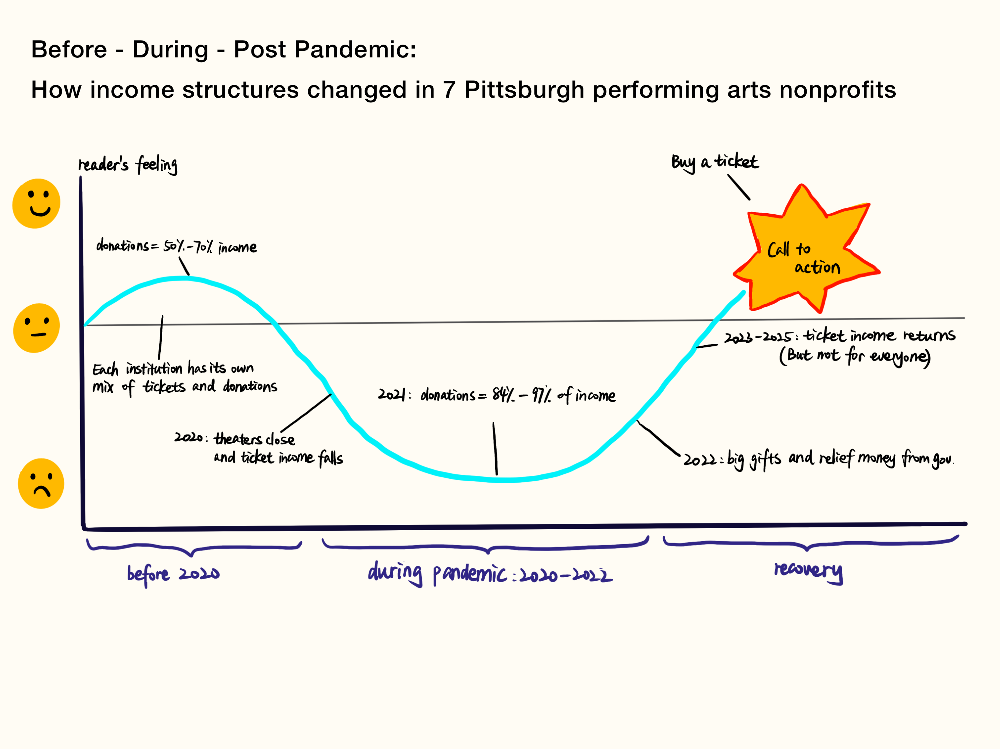

| [home page](https://zoya2130.github.io/dataviz-portfolio/) | [data viz examples](dataviz-examples) | [critique by design](critique-by-design) | [final project I](final-project-part-one) | [final project II](final-project-part-two) | [final project III](final-project-part-three) |

# Zoe Wang's Data Visualization Portfolio

This is my public portfolio for Telling Stories with Data (94-870) at Carnegie Mellon University. It shows my data visualization work from this course.

## About me

I am a graduate student in Arts Management at CMU. I have experience in theater programming, development support, and event coordination. I am skilled in Salesforce database management and international touring coordination.

## What I hope to learn

In this course, I hope to learn how to show data in clear and attractive charts. I want to use Tableau to complete my assignments. I also want to learn the main principles and methods of chart design.

## My work

### Final project: Who Pays for the Show?

This project follows the income of seven Pittsburgh performing arts nonprofits before, during, and after the pandemic.

[Read the final story](https://carnegiemellon.shorthandstories.com/who-pays-for-the-show/index.html)

How I built it: [Part I: Outline and sketches](final-project-part-one) | [Part II: Wireframes and user research](final-project-part-two) | [Part III: Final story](final-project-part-three)

### Critique and redesign: PISA 2025

I critiqued an OECD chart, tested my ideas with classmates, and built a new map and bar chart in Tableau.

[View the redesign](critique-by-design)

### Visualizing government debt

A heat map and a line chart show government debt as a percent of GDP from 2007 to 2024.

[View the charts](dataviz-examples)
