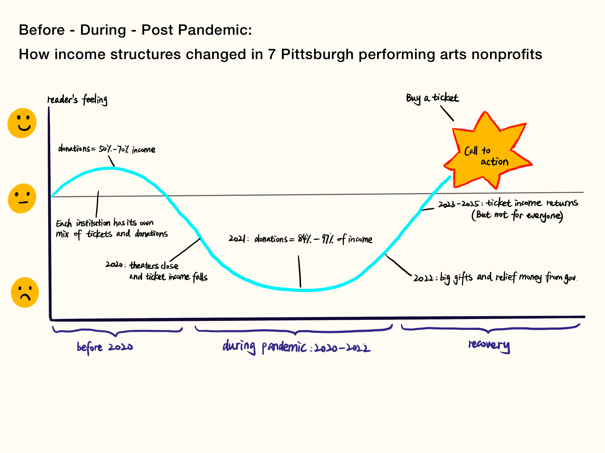

| [home page](https://cmustudent.github.io/tswd-portfolio-templates/) | [data viz examples](dataviz-examples) | [critique by design](critique-by-design) | [final project I](final-project-part-one) | [final project II](final-project-part-two) | [final project III](final-project-part-three) |

# Final Project, Part 1: How Seven Pittsburgh Arts Nonprofits Survived the Pandemic

Zoe Wang | 94-870 Telling Stories with Data | Carnegie Mellon University

**On this page:** [1. Outline](#1-outline) | [2. Initial sketches](#2-initial-sketches) | [3. The data](#3-the-data) | [4. Method and medium](#4-method-and-medium) | [References](#references)

---

## 1. Outline

### Summary

**Question**

When theaters closed in 2020, ticket sales almost stopped. Most organizations survived. How did they do it, and what do their income structures look like now?

This project follows seven Pittsburgh performing arts nonprofits from FY2017 to FY2025. I use their public Form 990 tax filings to see how ticket income and donations changed before, during, and after the pandemic. Pittsburgh audiences know these groups well. Their Form 990 reports are free on ProPublica Nonprofit Explorer.

I want to show three things:

- The groups had very different income mixes in 2019.
- Donations carried almost all of the load in 2021.
- The years after 2021 look different for each group.

In this project, "ticket and program income" means the Program Service Revenue line on Form 990.

**Background**

*What changed for American performing arts?*

Across the country, the pandemic hit earned income first and hardest. [A report from the Theatre Communications Group and SMU DataArts](https://culturaldata.org/learn/data-at-work/2023/tcg-theatre-facts-2021/) found that earned revenue at nonprofit theaters dropped 61% from 2017 to 2021. In 2021, donations and grants covered almost all expenses, and the report links this to government relief. Relief funding was large. In the first months of the pandemic, [the Paycheck Protection Program alone gave $1.1 billion to 5,713 nonprofit arts groups](https://culturaldata.org/learn/data-at-work/2020/ppp-data-on-preserving-jobs-in-the-arts-culture-sector/).

The next year, ticket income grew a lot, but [it was still 55% below 2018](https://tcg.org/Web/News/Press-Releases/Theatre-Facts-2022-Report-Published.aspx). By 2023, [ticket revenue at nonprofit theaters was still about one quarter below 2019 after inflation, and contributed income fell 15% from the year before as relief ended](https://culturaldata.org/learn/data-at-work/2025/theatre-facts-2023/). [A story in American Theatre](https://americantheatre.org/?p=87762) explains that private donors had not returned as strongly as hoped once inflation is counted. Across all arts groups, [contributed revenue was 53% of operating revenue in fiscal year 2023](https://culturaldata.org/national-trends-2024/funding-sources/), so many organizations now depend more on donors.

*What changed in Pittsburgh?*

Pittsburgh followed a similar path. [A Greater Pittsburgh Arts Council analysis, reported by Pittsburgh Magazine,](https://www.pittsburghmagazine.com/arts-in-pittsburgh-can-the-show-go-on/) found that 84% of local arts groups canceled events and about 68% closed their buildings temporarily.

Local news reports show the same difference between tickets and donations. [Three months after indoor shows returned, most groups still had far fewer people in their seats.](https://www.wesa.fm/arts-sports-culture/2021-12-08/pittsburgh-arts-groups-have-returned-to-indoor-shows-but-not-all-patrons-have-followed) A year later, [subscriptions and single tickets still declined, while grants and donations stayed fairly steady](https://www.wesa.fm/arts-sports-culture/2022-07-11/pittsburgh-performance-troupes-still-face-pandemic-challenges). [The 2025 Supplemental Regional Report](https://www.pittsburghartscouncil.org/sites/default/files/documents/Pittsburgh%20-%20PA%20CultureCheck%20Supplemental%20Report%20-%202025%20v1.1.pdf) says attendance in the Pittsburgh region is rising but remains below 2019, and performing arts groups recovered faster.

**Why these organizations**

| Organization | Art form | Founded | Total revenue, FY2019 |
|---|---|---|---|
| Pittsburgh Symphony | Orchestra | 1895 | $36.5M |
| Pittsburgh Opera | Opera | 1939 | $7.1M |
| Pittsburgh Ballet Theatre | Ballet | 1969 | $12.3M |
| Pittsburgh Public Theater | Theater | 1975 | $6.0M |
| City Theatre | Theater | 1975 | $3.4M |
| Quantum Theatre | Theater | 1990 | $1.3M |
| Attack Theatre | Dance | 1994 | $0.8M |

*What is the same*

All of them are leading names in their art form in Pittsburgh and most have a long history. The Symphony began in 1895, the Opera in 1939, and Pittsburgh Ballet Theatre in 1969. The two theater companies, City Theatre and Pittsburgh Public Theater, both started in 1975. Four of the seven perform in the Cultural District, an area built by the Pittsburgh Cultural Trust. The other three work in other parts of the city.

*What is the difference*

Size is the biggest difference between them. In FY2019, the Symphony had about 44 times the revenue of Attack Theatre. The art forms are also different: an orchestra, an opera company, a ballet company, a dance company, and three theater companies. Even the three theaters are not the same. The Public Theater plays in a large downtown house. City Theatre has its own campus and focuses on new plays. Quantum Theatre makes theater in places that are not theaters. Attack Theatre is described as the largest contemporary dance company in Pittsburgh.

The groups also had different income structures before the pandemic. In FY2019, ticket and program income was a much larger part of income at Pittsburgh Ballet Theatre and the Public Theater than at the Symphony and the Opera. So if the same trend appears simultaneously in such different institutions, the cause is probably the pandemic and not one organization's choice.

### Audience and user stories

My audience is people who care about how Pittsburgh arts groups pay their bills. This includes donors, board members, arts staff, and audience members.

- As a **donor**, I want to see how much arts groups depend on gifts, so that I understand what my gift does.
- As a **board member of a small theater**, I want to compare my group with larger groups, so that I can plan for the next crisis.
- As an **audience member**, I want to see how much of a group's income comes from tickets, so that I understand why arts groups also ask for donations.

### Project structure

**One sentence summary:** When the shows stopped, donations kept Pittsburgh's performing arts groups alive, and today each group has a different balance between ticket income and donors.

**Story arc**

| Part | Working header | Main point | Chart |
|---|---|---|---|
| Opening | "When the lights went out" | The question: how did arts groups survive with no ticket sales? | None (text and a short timeline) |
| Act 1: Before | "Seven groups, seven income mixes" | In FY2019, the groups paid for their work in very different ways. | 2019 income structure |
| Act 2: During | "Donors carried the load" | Donations became a much larger share of income in 2020 and 2021. | 2020 to 2021 donations |
| Act 3: Turning point | "2022: the biggest year" | Three groups had their biggest revenue year. | 2022 revenue |
| Act 4: Now | "No single recovery story" | Compared with 2019, 2 groups rely more on donations and 1 relies less. | 2025 (2024) vs 2019 donations |
| Closing | "What this means" | What donors, boards, and audiences can learn from the seven groups. | None (text) |

---

## 2. Initial sketches

### Act 1: Seven groups, seven income mixes
*Before the pandemic: 2019 income structure*

This chart shows how each group paid for its work in FY2019.

<noscript></noscript><object class='tableauViz'  style='display:none;'><param name='host_url' value='https%3A%2F%2Fpublic.tableau.com%2F' /> <param name='embed_code_version' value='3' /> <param name='site_root' value='' /><param name='name' value='2019incomed&#47;2019incomestructure' /><param name='tabs' value='no' /><param name='toolbar' value='yes' /><param name='static_image' value='https:&#47;&#47;public.tableau.com&#47;static&#47;images&#47;20&#47;2019incomed&#47;2019incomestructure&#47;1.png' /> <param name='animate_transition' value='yes' /><param name='display_static_image' value='yes' /><param name='display_spinner' value='yes' /><param name='display_overlay' value='yes' /><param name='display_count' value='yes' /><param name='language' value='en-GB' /></object>
                

### Act 2: Donors carried the load
*During the pandemic: 2020 to 2021 donations*

In FY2021, donations became a much larger share of income at six of the seven groups. Attack Theatre is the exception.

<noscript></noscript><object class='tableauViz'  style='display:none;'><param name='host_url' value='https%3A%2F%2Fpublic.tableau.com%2F' /> <param name='embed_code_version' value='3' /> <param name='site_root' value='' /><param name='name' value='2020-2021donationd&#47;2020-2021donations' /><param name='tabs' value='no' /><param name='toolbar' value='yes' /><param name='static_image' value='https:&#47;&#47;public.tableau.com&#47;static&#47;images&#47;20&#47;2020-2021donationd&#47;2020-2021donations&#47;1.png' /> <param name='animate_transition' value='yes' /><param name='display_static_image' value='yes' /><param name='display_spinner' value='yes' /><param name='display_overlay' value='yes' /><param name='display_count' value='yes' /><param name='language' value='en-GB' /></object>
                

### Act 3: 2022, the biggest year
*In 2022, three groups had their biggest revenue year*

The Opera ($15.1M), Pittsburgh Ballet Theatre ($16.2M), and Quantum Theatre ($3.0M) each had their highest revenue of the nine years in FY2022.

<noscript></noscript><object class='tableauViz'  style='display:none;'><param name='host_url' value='https%3A%2F%2Fpublic.tableau.com%2F' /> <param name='embed_code_version' value='3' /> <param name='site_root' value='' /><param name='name' value='2022revenued&#47;2022revenue' /><param name='tabs' value='no' /><param name='toolbar' value='yes' /><param name='static_image' value='https:&#47;&#47;public.tableau.com&#47;static&#47;images&#47;20&#47;2022revenued&#47;2022revenue&#47;1.png' /> <param name='animate_transition' value='yes' /><param name='display_static_image' value='yes' /><param name='display_spinner' value='yes' /><param name='display_overlay' value='yes' /><param name='display_count' value='yes' /><param name='language' value='en-GB' /></object>

### Act 4: No single recovery story
*2025 (2024) compared with 2019 donations*

This chart compares the share of income from donations in the latest year with FY2019. I use FY2025 for six groups. The Public Theater has no FY2025 filing yet, so I use FY2024 for it.

<noscript></noscript><object class='tableauViz'  style='display:none;'><param name='host_url' value='https%3A%2F%2Fpublic.tableau.com%2F' /> <param name='embed_code_version' value='3' /> <param name='site_root' value='' /><param name='name' value='newsestvs2019d&#47;20252024vs2019donations' /><param name='tabs' value='no' /><param name='toolbar' value='yes' /><param name='static_image' value='https:&#47;&#47;public.tableau.com&#47;static&#47;images&#47;ne&#47;newsestvs2019d&#47;20252024vs2019donations&#47;1.png' /> <param name='animate_transition' value='yes' /><param name='display_static_image' value='yes' /><param name='display_spinner' value='yes' /><param name='display_overlay' value='yes' /><param name='display_count' value='yes' /><param name='language' value='en-GB' /></object>
                

---

## 3. The data

### Data source

All numbers come from Form 990, the yearly tax form for nonprofit organizations. ProPublica Nonprofit Explorer shows the numbers from these filings for free. I used one ProPublica page for each group:

- [Pittsburgh Symphony](https://projects.propublica.org/nonprofits/organizations/250986052)
- [Pittsburgh Opera](https://projects.propublica.org/nonprofits/organizations/251073139)
- [Pittsburgh Ballet Theatre](https://projects.propublica.org/nonprofits/organizations/237101094)
- [Pittsburgh Public Theater](https://projects.propublica.org/nonprofits/organizations/237398683)
- [City Theatre](https://projects.propublica.org/nonprofits/organizations/251554580)
- [Quantum Theatre](https://projects.propublica.org/nonprofits/organizations/251760895)
- [Attack Theatre](https://projects.propublica.org/nonprofits/organizations/201909284)

**My copy of the data:** [pittsburgh arts 990 2017-2025.xlsx](pittsburgh_arts_990_2017-2025.xlsx).

### How I use the data

For each group and each year, I copied four numbers from the filing: total revenue, contributions, program service revenue, and investment income. Then I calculated the share of each source in income. The donation share tells us how much a group depends on donors. The ticket and program share tells us how much it depends on ticket and program income.

---

## 4. Method and medium

I plan to build the final project as a scrolling story in **Shorthand**. I will make the charts in **Tableau Public** and embed them in the Shorthand story. The sketches above are the first versions of those charts.

### Special project proposal: gallery show video

I would like to propose a project for the data viz and data art gallery show at the Wilkins School Community Center in January 2027. My idea is a video of about five minutes. It tells the same story as the Shorthand project.

The video uses the same four acts as the story arc. A voiceover explains each act. I may try to add animation to the charts, but I have not learned how to do this yet. Each of the seven groups keeps its own color across the whole video.

---

## References

- ProPublica Nonprofit Explorer. Form 990 filings for the seven organizations listed in [The data](#3-the-data).
- SMU DataArts and Theatre Communications Group. [Theatre Facts 2021](https://culturaldata.org/learn/data-at-work/2023/tcg-theatre-facts-2021/).
- SMU DataArts. [PPP Data on Preserving Jobs in the Arts and Culture Sector](https://culturaldata.org/learn/data-at-work/2020/ppp-data-on-preserving-jobs-in-the-arts-culture-sector/).
- Theatre Communications Group. [Theatre Facts 2022 press release](https://tcg.org/Web/News/Press-Releases/Theatre-Facts-2022-Report-Published.aspx).
- SMU DataArts. [Theatre Facts 2023](https://culturaldata.org/learn/data-at-work/2025/theatre-facts-2023/).
- American Theatre. [Theatre Facts 2023 coverage](https://americantheatre.org/?p=87762).
- SMU DataArts. [National Trends 2024, Funding Sources](https://culturaldata.org/national-trends-2024/funding-sources/).
- Pittsburgh Magazine. [Arts in Pittsburgh: Can the Show Go On?](https://www.pittsburghmagazine.com/arts-in-pittsburgh-can-the-show-go-on/)
- WESA. [Pittsburgh arts groups have returned to indoor shows, but not all patrons have followed](https://www.wesa.fm/arts-sports-culture/2021-12-08/pittsburgh-arts-groups-have-returned-to-indoor-shows-but-not-all-patrons-have-followed) (December 2021).
- WESA. [Pittsburgh arts groups still face pandemic challenges](https://www.wesa.fm/arts-sports-culture/2022-07-11/pittsburgh-performance-troupes-still-face-pandemic-challenges) (July 2022).
- PA Humanities, Greater Pittsburgh Arts Council, and Greater Philadelphia Cultural Alliance. [PA CultureCheck 2025, Greater Pittsburgh Supplemental Regional Report](https://www.pittsburghartscouncil.org/sites/default/files/documents/Pittsburgh%20-%20PA%20CultureCheck%20Supplemental%20Report%20-%202025%20v1.1.pdf).
- SMU DataArts. [Attack Theatre case study](https://culturaldata.org/learn/case-studies/attack-theatre-1).
- Pittsburgh Public Theater. [About](https://ppt.org/ppt_home/about).
- American Theatre. [Know a Theatre: City Theatre Company of Pittsburgh](https://americantheatre.org/2015/08/19/know-a-theatre-city-theatre-company-of-pittsburgh).
- Quantum Theatre. [Experiments with the language and location of theatre](https://quantumtheatre.com/experiments-with-the-language-and-location-of-theatre).

## AI acknowledgements

I used Microsoft Copilot to collect and create the data table: [Shared Copilot Chat](https://copilot.cloud.microsoft/chat/share/eyJzaGFyZUlkIjoiOGZkMDQzMGYtYWYxZS00MzhmLTliYWEtZjg5ZDdhNzgxMjA5IiwiY29udmVyc2F0aW9uSWQiOiIxNWQ2OWZkMC0yOWQ1LTQ1NDktYTU1YS00MjhmOTJiMThlYjIifQ%3D%3D)

---

| [home page](https://cmustudent.github.io/tswd-portfolio-templates/) | [data viz examples](dataviz-examples) | [critique by design](critique-by-design) | [final project I](final-project-part-one) | [final project II](final-project-part-two) | [final project III](final-project-part-three) |
